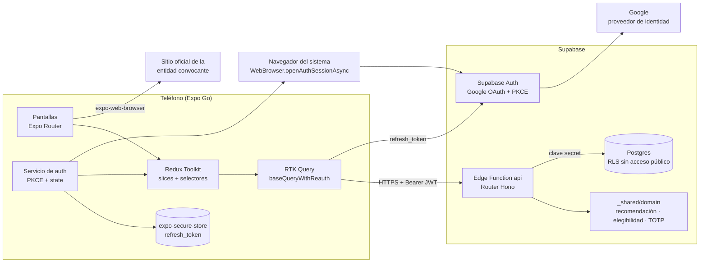
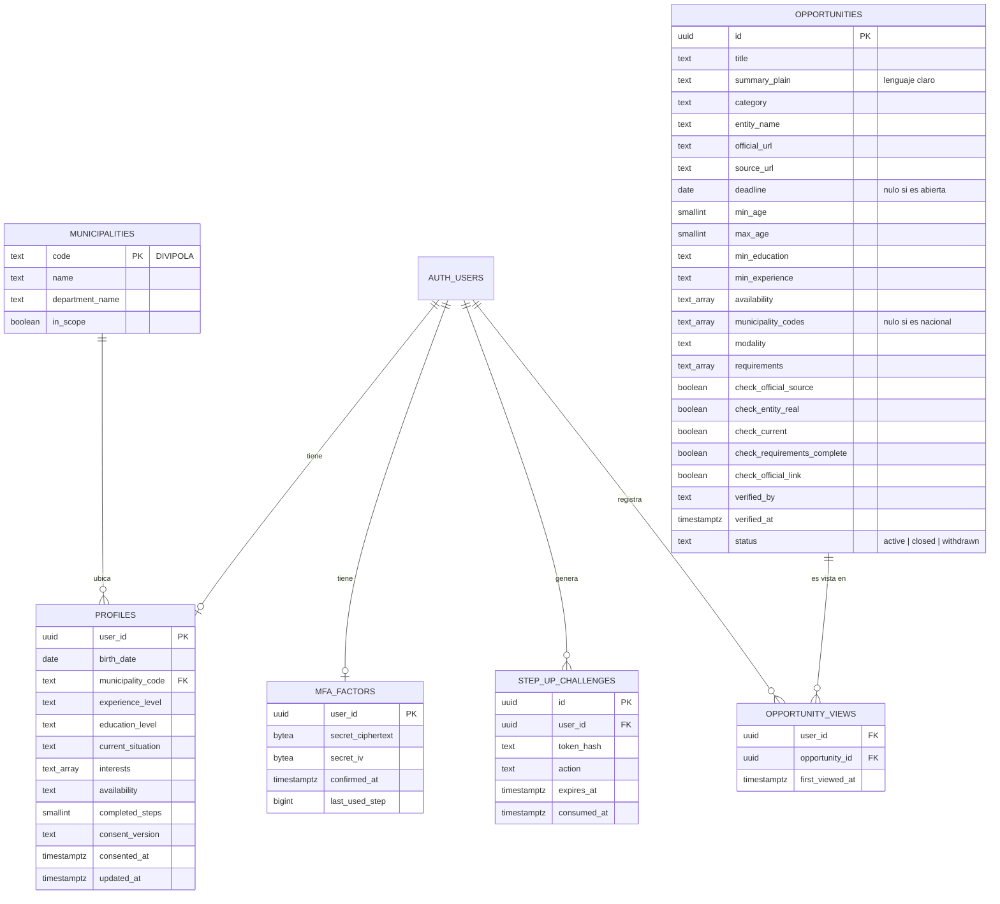
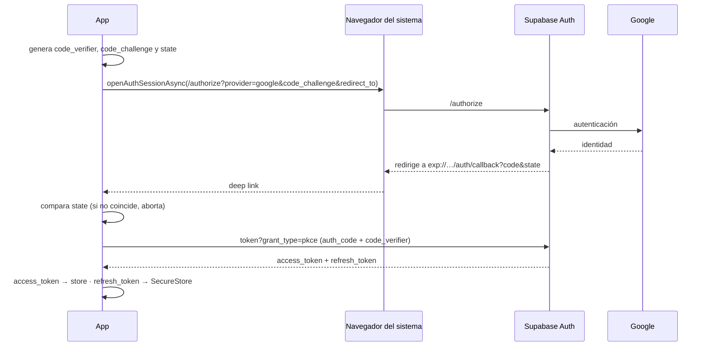
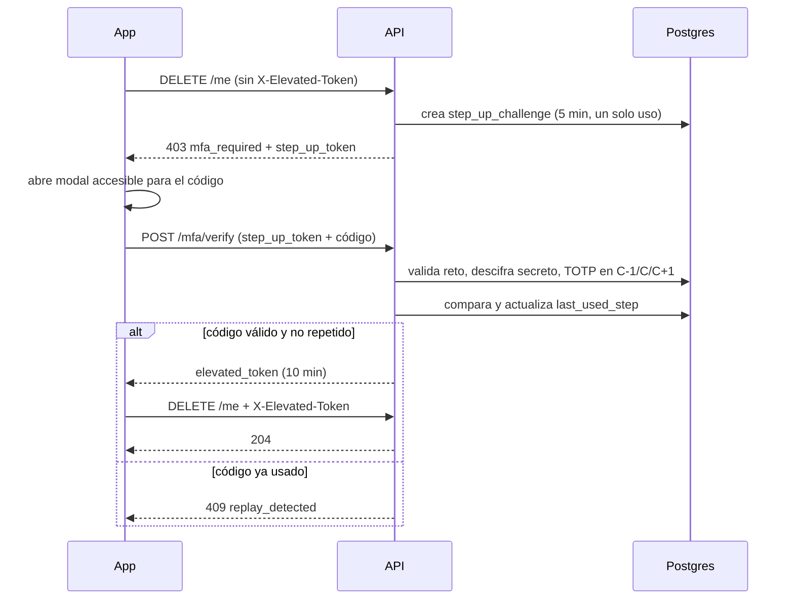

# Diseño del backend: arquitectura, modelo de datos, endpoints y flujos

- **Estado:** diseño inicial derivado de las decisiones [0001](../decisions/0001-stack-movil-y-backend.md)–[0004](../decisions/0004-alcance-del-mvp.md).
- **Alcance:** describe lo que se va a construir, no lo que ya existe. Los nombres de tablas, campos y valores se ajustarán al implementar, y cada cambio debe reflejarse aquí.

## 1. Arquitectura de extremo a extremo



## 2. Modelo de datos (inicial)

`auth.users` es administrada por Supabase Auth. Las demás tablas están en el esquema `public`, con RLS activado y **sin políticas** para `anon` ni `authenticated`; solo la Edge Function accede, con la clave *secret* de Supabase.



Valores enumerados tentativos:

| Campo | Valores |
|---|---|
| `category` / `interests` | `employment`, `training`, `scholarship`, `subsidy`, `entrepreneurship` |
| `experience_level` | `none`, `lt_1y`, `1_3y`, `gt_3y` |
| `education_level` | `secondary_incomplete`, `secondary`, `technical`, `technologist`, `university_incomplete`, `university`, `postgraduate` |
| `current_situation` | `studying`, `working`, `both`, `neither` |
| `availability` | `full_time`, `part_time`, `weekends`, `flexible` |
| `modality` | `in_person`, `virtual`, `hybrid` |

## 3. Endpoints

Base: `https://<proyecto>.supabase.co/functions/v1/api`.

Todas las respuestas de error usan el formato `{ "error": "<codigo>", "message": "<texto en lenguaje claro>" }`, con campos adicionales cuando aplica.

| Método | Ruta | Autenticación | Descripción |
|---|---|---|---|
| `GET` | `/health` | Pública | Estado del servicio. |
| `GET` | `/catalog` | Pública | Municipios en alcance y valores válidos para el formulario de perfil. |
| `GET` | `/me/profile` | `access_token` | Perfil actual y pasos completados (permite retomar). |
| `PUT` | `/me/profile` | `access_token` | Guarda uno o varios pasos del perfil. Exige consentimiento registrado. Responde `422` con errores por campo. |
| `GET` | `/recommendations` | `access_token` | Entre 4 y 5 oportunidades vigentes y elegibles para el perfil guardado, cada una con su razón. Responde `409 profile_incomplete` si falta información. |
| `GET` | `/opportunities/:id` | `access_token` | Detalle: requisitos, entidad, fuente, vigencia, verificación y enlace oficial. Registra la vista. |
| `POST` | `/mfa/enroll` | `access_token` | Genera el secreto y devuelve el URI `otpauth://`. |
| `POST` | `/mfa/enroll/confirm` | `access_token` | Activa el factor tras validar un primer código. |
| `POST` | `/mfa/verify` | `access_token` + `step_up_token` | Valida el código TOTP y devuelve `elevated_token`. Errores: `401 invalid_code`, `409 replay_detected`, `410 step_up_expired`. |
| `GET` | `/me/data-export` | `access_token` + `X-Elevated-Token` | Exporta los datos personales (Ley 1581). Sin elevación: `403 mfa_required`. |
| `DELETE` | `/me` | `access_token` + `X-Elevated-Token` | Elimina perfil, vistas, factor MFA y la cuenta. Sin elevación: `403 mfa_required`. |

Supabase Auth, que no es código propio, atiende `authorize`, el canje `grant_type=pkce`, la renovación `grant_type=refresh_token` y `logout`.

## 4. Flujos principales

### 4.1 Inicio de sesión con PKCE



### 4.2 Petición con renovación silenciosa

```mermaid
sequenceDiagram
  participant UI
  participant RTKQ as baseQueryWithReauth
  participant API
  participant Auth as Supabase Auth
  UI->>RTKQ: GET /recommendations
  RTKQ->>API: Bearer access_token (vencido)
  API-->>RTKQ: 401
  RTKQ->>Auth: refresh (una sola vez; las demás peticiones esperan)
  alt renovación exitosa
    Auth-->>RTKQ: nuevo access_token + refresh_token
    RTKQ->>API: reintento
    API-->>UI: 200 recomendaciones
  else refresh inválido
    RTKQ->>RTKQ: borra SecureStore y sesión
    RTKQ-->>UI: navegar a bienvenida con aviso accesible
  end
```

### 4.3 Step-up para exportar o eliminar datos



## 5. Secretos y variables de entorno

| Variable | Dónde | Nota |
|---|---|---|
| `EXPO_PUBLIC_API_URL` | App (`apps/mobile/.env`) | Pública. URL base de la función `api`. **Ya existe** en `apps/mobile/.env.example`. |
| `EXPO_PUBLIC_SUPABASE_URL` | App | Pública. Necesaria para Supabase Auth. |
| `EXPO_PUBLIC_SUPABASE_PUBLISHABLE_KEY` | App | Clave *publishable* de Supabase. Es pública y no da acceso a tablas porque RLS no tiene políticas para `anon` ni `authenticated`. |
| Clave *secret* de Supabase | Secreto de la Edge Function | Reemplaza a la antigua `service_role`. Nunca en la app ni en Git. |
| `TOTP_ENCRYPTION_KEY` | Secreto de la Edge Function | Clave AES-GCM de 256 bits. |
| `ELEVATED_TOKEN_SECRET` | Secreto de la Edge Function | Firma HS256 del `elevated_token`. |

La Supabase CLI 3.x genera las funciones con el modelo de claves *publishable* y *secret* (ver la plantilla en `supabase/functions/`). Los nombres de las variables que faltan se registran en los `.env.example` cuando se implemente cada módulo.
